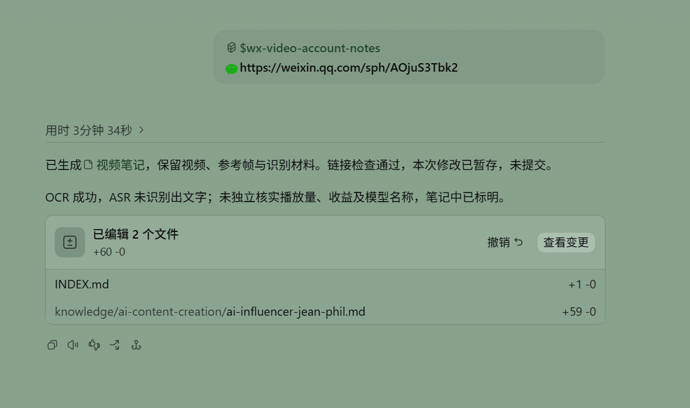
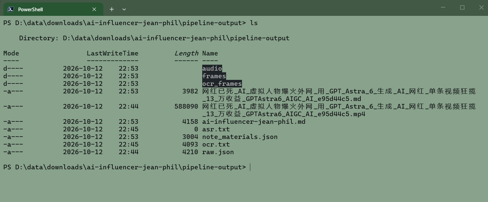

# wx-video-account-notes

Download WeChat Channels videos or image posts from a share link, extract OCR/ASR note materials, and have an agent write a Markdown note.

[中文 README](README.md) · [](https://github.com/MuZiJin701/wx-video-account-notes/actions/workflows/tests.yml)

> **Self-hosted login:** the operator runs a command that starts temporary headless Chromium through Playwright and obtains Yuanbao Cookie through WeChat QR login. Manual Cookie pasting remains available. Both paths validate full parsing before replacement and preserve the old file on failure. See the [self-hosting guide (Chinese)](docs/resolver-deployment.md).

## See it in action





OCR succeeded in this example; ASR recognized no speech. Notes flag failures and uncertainty.

## Get started

Supports Windows x64, Intel macOS x64, and Linux x64. The first run downloads a private Python runtime, dependencies, FFmpeg, and models from sources including GitHub Releases and Hugging Face. It needs network access and disk space; later runs reuse them.

An available system uv (0.11.25 or newer) is preferred. Missing or incompatible installations fall back to the existing pinned, checksum-verified project-private uv.

### 1. Install the Skill

```sh
npm install -g skills
skills add https://github.com/MuZiJin701/wx-video-account-notes.git -g -y
```

Codex users can also install the plugin:

```sh
codex plugin marketplace add https://github.com/MuZiJin701/wx-video-account-notes.git
codex plugin add wx-video-account-notes@wx-video-account-notes-dev
```

With `cc-switch`, enter the repository URL.

### Update the Skill

After installing with `skills add ... -g`, update only this global Skill with:

```sh
skills update wx-video-account-notes -g
```

Back up any configuration you changed in the installed Skill before updating. This command applies to installations managed by the `skills` CLI; for Codex plugin marketplace or `cc-switch` installations, use the corresponding tool's update method.

### 2. Send a share link

By default, the Skill uses the maintainer's resolver. You do not need a server or credentials. Send a real link to your agent:

```text
Download the content from this WeChat Channels share link and write a note:
https://weixin.qq.com/sph/your_share_id_here
```

The default resolver URL is now `http://14.103.98.50/api/channels/parse_sph`. Update older Skill installations or change `api_url` in the installed copy's `runtime/resolver_config.json`, keeping the existing `access_key`. Deployment and acceptance on Volcengine are still pending; changing the URL alone does not make the service available.

To choose an output directory, include it in the request, for example, “Save this note under D:\notes\wx.”

### Want to use your own server?

Follow the [self-hosting guide (Chinese)](docs/resolver-deployment.md) on a Linux x64 server with systemd. Run maintenance in an interactive SSH terminal: valid Cookie is reused, while missing or explicitly expired login opens a WeChat QR. The browser closes when the command ends. If scanning cannot complete, use the existing no-echo manual Cookie update command.

WeChat scanning, full parsing, Cookie publication and subsequent reuse passed on an isolated server. Phone scanning of the ordinary SSH character QR, live expiry refresh, new-account registration and production systemd lifecycle still need separate validation. Additional verification may occur; there is no scheduled login or email alert. See the [acceptance record and limits (Chinese)](docs/research/yuanbao-manual-qr-login.md#微信手动维护改造与真实验收2026-10-21).

## Output files

```text
<output-dir>/<slug>[_N]/
  <slug>.<format>      # video posts, H.264 preferred
  images/              # original images in order
  cover.<format>       # when available
  background_music.<format> # when available
  index.html           # offline archive and failures
  note_materials.json  # notes and download, OCR, ASR status
  raw.json             # raw response; may contain temporary access parameters
  ocr.txt, asr.txt
  ocr_frames/, frames/, audio/
  <slug>.md            # final note
```

Each run creates a separate child directory, including when an output directory is specified. Original images support OCR and visual analysis; video reference frames are in `frames/`. A failed media download preserves successful files, records the failure, and returns a nonzero status while keeping the archive available. Availability depends on the resolver response; private, inaccessible or encrypted media is not guaranteed.

## How it works and current limits

- The server only resolves share links. Media download, OCR, ASR, and note writing run locally; no GPU or system FFmpeg is required.
- The default resolver uses public HTTP, so share links and results travel in plaintext. Its shared access key ships with the public Skill and is not secret. The service handles at most 30 requests per minute across all users.
- The maintainer updates the default resolver's Yuanbao login. Self-hosting reuses valid Cookie and lets the operator refresh expired login through a WeChat QR in an SSH terminal or manual Cookie pasting. HTTPS can be configured; there is no scheduled login or email notification.
- ARM64, GPU inference, and offline first-time setup are not supported. The private Python version is 3.13.14; ASR uses faster-whisper tiny on CPU.

## Development

```sh
cd plugins/wx-video-account-notes/skills/wx-video-account-notes
uv sync --locked
uv run --locked python -m unittest discover -s runtime/tests
```

Run server tests from the repository root with `python3 -m unittest discover -s server` (standard library only). For real bootstrap and end-to-end checks, use the [manual acceptance checklist](plugins/wx-video-account-notes/skills/wx-video-account-notes/tests/test-cases.md).

GitHub Actions runs three-platform unit tests and a credential-free Linux Chromium launch, JavaScript, and profile-persistence smoke check, with manual dispatch support. Personal credentials are not uploaded to CI. The [isolated checks](plugins/wx-video-account-notes/skills/wx-video-account-notes/tests/test-cases.md#standalone-wechat-login-check) cover WeChat QR login and full parsing; offline tests and credential-free CI do not establish successful cloud authentication.

## More documentation

- [Self-hosting and troubleshooting (Chinese)](docs/resolver-deployment.md)
- [WeChat QR and manual Cookie checks (Chinese)](docs/research/yuanbao-manual-qr-login.md) · [Historical QQ password and mail experiments (Chinese)](docs/research/yuanbao-qq-login.md)
- [Skill execution guide (Chinese)](plugins/wx-video-account-notes/skills/wx-video-account-notes/SKILL.md)
- [Repository map (Chinese)](目录说明.md) · [Domain glossary (Chinese)](GLOSSARY.md) · [Architecture decisions](docs/adr/)
- [Resolver architecture (Chinese)](docs/research/wx-channels-architecture.md) · [Tests and evaluation](plugins/wx-video-account-notes/skills/wx-video-account-notes/tests/test-cases.md) · [Changelog](CHANGELOG.md)

Read [AGENTS.md](AGENTS.md) before contributing. Use GitHub Issues for requests and bugs. Licensed under [MIT](LICENSE).
