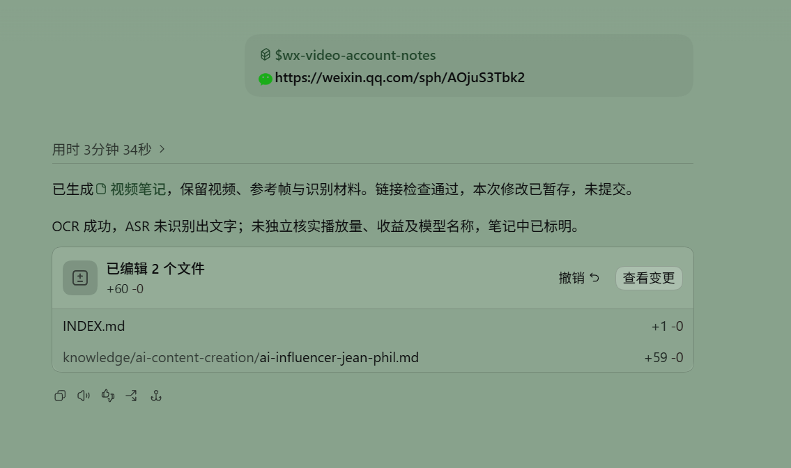
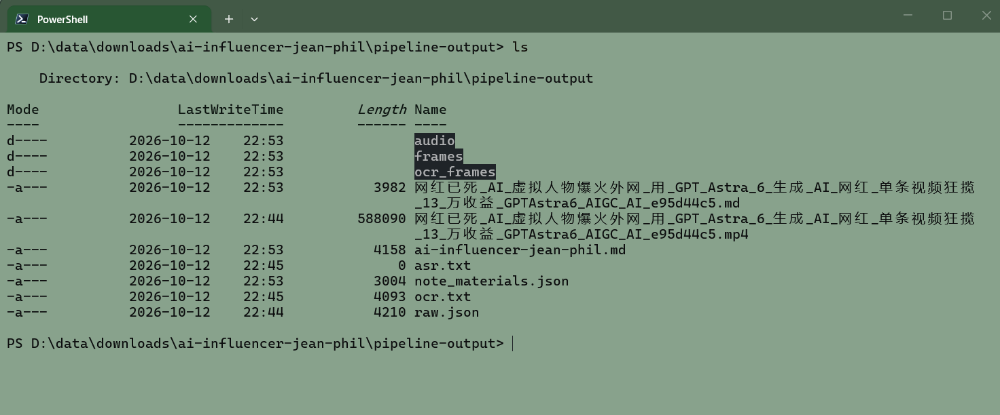

# wx-video-account-notes

Turn a WeChat Channels share link into downloaded videos or images, offline archives, OCR/ASR note materials, and a structured Markdown note written by your AI agent.

[简体中文](README.md) · [](https://github.com/MuZiJin701/wx-video-account-notes/actions/workflows/tests.yml)

## See it in action





In this example, OCR succeeded while ASR found no speech; the final note flags any missing or uncertain parts.

## Get started

- **Supported platforms**: Windows x64, Intel macOS x64, and Linux x64.
- **Ready out of the box**: Uses the maintainer's default resolver by default — no server setup or API key required.
- **First run**: Automatically downloads a private local runtime (Python, FFmpeg, and OCR/ASR models). Network access and disk space are required on the first run and reused afterward.

### 1. Install and update

Pick one installation method per host (`skills` CLI is recommended for most users).

#### Option 1: Using the `skills` CLI (recommended)

Run the command below and select your host (Codex, Claude Code, Antigravity, Grok Build, or GitHub Copilot CLI):

```sh
npm install -g skills
skills add https://github.com/MuZiJin701/wx-video-account-notes.git -g
```

Update later:

```sh
skills update wx-video-account-notes -g
```

If you use `cc-switch`, add `https://github.com/MuZiJin701/wx-video-account-notes.git` directly.

#### Option 2: Native plugin CLI commands

| Host | Install command |
| --- | --- |
| Codex | `codex plugin marketplace add https://github.com/MuZiJin701/wx-video-account-notes.git`<br>`codex plugin add wx-video-account-notes@wx-video-account-notes-dev` |
| Claude Code | `claude plugin marketplace add MuZiJin701/wx-video-account-notes`<br>`claude plugin install wx-video-account-notes@wx-video-account-notes-dev` |
| Antigravity | `agy plugin install https://github.com/MuZiJin701/wx-video-account-notes` |
| Grok Build | `grok plugin marketplace add MuZiJin701/wx-video-account-notes`<br>`grok plugin install wx-video-account-notes --trust` |
| GitHub Copilot CLI | `copilot plugin marketplace add MuZiJin701/wx-video-account-notes`<br>`copilot plugin install wx-video-account-notes@wx-video-account-notes-dev` |

To update a native plugin installation, run your host's update command (for example, `codex plugin marketplace upgrade wx-video-account-notes-dev` or `claude plugin update wx-video-account-notes@wx-video-account-notes-dev`) or re-run the install command, then open a new session.

### 2. Send a share link to generate notes

To prevent accidental triggers during normal chat, this Skill is **explicit-invocation only**. Select it explicitly before sending your link:

- **Codex**: Type `$` and select `wx-video-account-notes`
- **Claude Code**: Use `/wx-video-account-notes` (standalone Skill) or `/wx-video-account-notes:wx-video-account-notes` (plugin)
- **Antigravity / Grok Build / Copilot CLI**: Invoke `/wx-video-account-notes` or choose it from the slash menu

Then send your WeChat Channels share link:

```text
Use $wx-video-account-notes to download the content from this WeChat Channels share link and write a note:
https://weixin.qq.com/sph/your_share_id_here
```

To save into a specific folder, just mention it in your message (for example, “Save this note under `D:\notes\wx`”).

## Output files

Each run creates a new subfolder under the output directory so existing notes are never overwritten:

```text
<output-dir>/<slug>[_N]/
  <slug>.mp4 / .mov        # downloaded video (when available)
  images/                  # original images for image posts (when available)
  cover.*                  # cover image (when available)
  background_music.*       # background music (when available)
  index.html               # offline archive viewer and error details
  note_materials.json      # structured materials for the agent
  raw.json                 # raw resolver response
  ocr.txt / asr.txt        # extracted on-screen text and speech transcript
  ocr_frames/ frames/ audio/
  <slug>.md                # final Markdown note
```

If an individual media file fails to download, everything else and the offline archive are still preserved and the failure is recorded.

## Notes and self-hosting

- **Runs locally without a GPU**: The server only resolves the share link. Downloading media, running OCR/ASR (CPU `faster-whisper tiny`), and writing the Markdown note all happen on your computer.
- **Default resolver limits**: The maintainer's default resolver runs over public HTTP and shares a 30 requests/minute limit across all users. Do not use it for private or sensitive links.
- **Self-hosted resolver (optional)**: To run your own private resolver, follow the [self-hosting guide (Chinese)](docs/resolver-deployment.md) on a Linux x64 server and maintain login cookies via WeChat QR scan or manual Cookie pasting.
- **Unsupported setups**: ARM64 (such as Apple Silicon Macs), GPU acceleration, and offline first-time setup are not supported.

## Development

Run the client and server unit test suites from the repository root:

```sh
uv run --locked --isolated --directory plugin/skills/wx-video-account-notes python -B -m unittest discover -s ../../../tests
python3 -m unittest discover -s server
```

More documentation:

- [Self-hosting guide and troubleshooting (Chinese)](docs/resolver-deployment.md)
- [Manual smoke test checklist](docs/test-cases.md) · [Skill execution guide (Chinese)](plugin/skills/wx-video-account-notes/SKILL.md)
- [Repository map (Chinese)](目录说明.md) · [Domain glossary (Chinese)](GLOSSARY.md) · [Architecture decisions](docs/adr/) · [Resolver architecture (Chinese)](docs/research/wx-channels-architecture.md) · [Changelog](CHANGELOG.md)

Read [AGENTS.md](AGENTS.md) before contributing, and use GitHub Issues for bug reports or requests. Licensed under [MIT](LICENSE).
