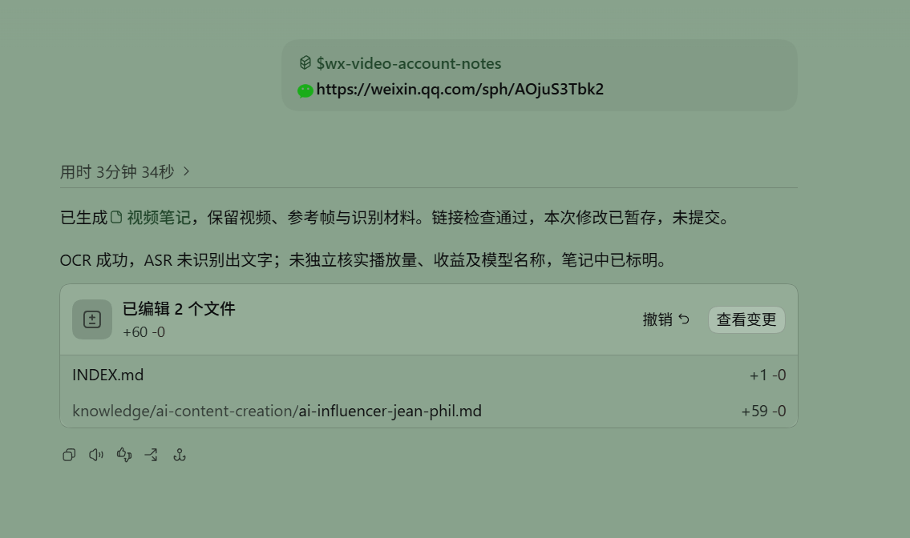
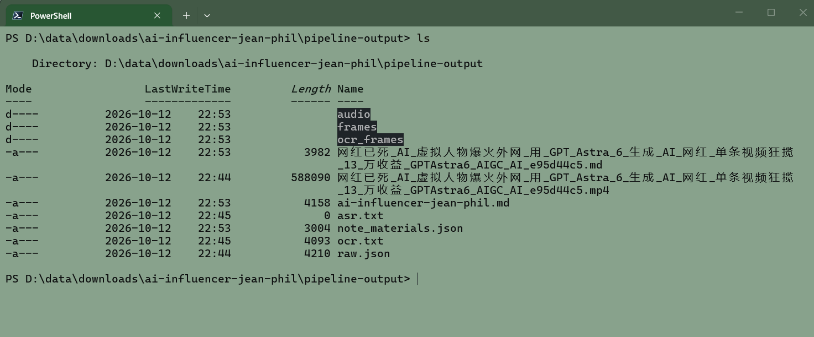

# wx-video-account-notes

输入微信视频号分享链接，自动下载视频或图文图片，提取画面文字（OCR）和语音字幕（ASR），并由 Agent 整理成结构化 Markdown 笔记与离线归档。

[English README](README.en.md) · [](https://github.com/MuZiJin701/wx-video-account-notes/actions/workflows/tests.yml)

## 使用效果





示例中画面文字识别（OCR）成功，语音转写（ASR）未识别出文字；最终笔记会自动标出失败或不确定项。

## 开始使用

- **支持系统**：Windows x64、macOS Intel x64、Linux x64。
- **开箱即用**：默认直接使用项目维护者提供的解析服务，无需自己搭建服务器或配置密钥。
- **首次运行**：会自动在本机下载项目私有运行环境（Python、FFmpeg 和识别模型），需要联网和一定磁盘空间，之后会自动复用。

### 1. 安装与更新

同一宿主选择下面一种方式安装即可（首次安装推荐用 `skills` CLI）。

#### 方式一：使用 `skills` CLI（推荐）

运行后按提示选择你使用的 Agent（Codex、Claude Code、Antigravity、Grok Build 或 GitHub Copilot CLI）：

```sh
npm install -g skills
skills add https://github.com/MuZiJin701/wx-video-account-notes.git -g
```

后续更新：

```sh
skills update wx-video-account-notes -g
```

如果使用 `cc-switch`，直接在其中输入仓库地址 `https://github.com/MuZiJin701/wx-video-account-notes.git` 即可。

#### 方式二：使用各 Agent 原生插件命令

| 宿主 | 安装命令 |
| --- | --- |
| Codex | `codex plugin marketplace add https://github.com/MuZiJin701/wx-video-account-notes.git`<br>`codex plugin add wx-video-account-notes@wx-video-account-notes-dev` |
| Claude Code | `claude plugin marketplace add MuZiJin701/wx-video-account-notes`<br>`claude plugin install wx-video-account-notes@wx-video-account-notes-dev` |
| Antigravity | `agy plugin install https://github.com/MuZiJin701/wx-video-account-notes` |
| Grok Build | `grok plugin marketplace add MuZiJin701/wx-video-account-notes`<br>`grok plugin install wx-video-account-notes --trust` |
| GitHub Copilot CLI | `copilot plugin marketplace add MuZiJin701/wx-video-account-notes`<br>`copilot plugin install wx-video-account-notes@wx-video-account-notes-dev` |

更新原生插件时，可执行对应宿主的更新命令（如 `codex plugin marketplace upgrade wx-video-account-notes-dev`、`claude plugin update wx-video-account-notes@wx-video-account-notes-dev`）或重新运行安装命令；更新后请开启新会话再使用。

### 2. 发送视频号分享链接生成笔记

为避免平时聊天误触发，该 Skill 设为**仅显式调用**。使用前请在客户端中主动选中它：

- **Codex**：输入 `$` 并选择 `wx-video-account-notes`
- **Claude Code**：输入 `/wx-video-account-notes`（独立安装）或 `/wx-video-account-notes:wx-video-account-notes`（插件安装）
- **Antigravity / Grok Build / Copilot CLI**：输入 `/wx-video-account-notes` 或从斜杠菜单中选择

选中后发送微信视频号分享链接即可：

```text
使用 $wx-video-account-notes 下载这个视频号分享链接的内容并生成笔记：
https://weixin.qq.com/sph/your_share_id_here
```

如果想保存到指定文件夹，在请求里直接写明即可，例如：“把这个链接整理到 `D:\notes\wx`”。

## 生成的文件

每次处理都会在输出目录下新建一个独立子目录，避免覆盖旧笔记：

```text
<output-dir>/<slug>[_N]/
  <slug>.mp4 / .mov        # 下载的视频（如有）
  images/                  # 图文动态的原始图片（如有）
  cover.*                  # 封面图（可用时）
  background_music.*       # 背景音乐（可用时）
  index.html               # 离线查看页面与失败提示
  note_materials.json      # 给 Agent 整理笔记用的结构化材料
  raw.json                 # 原始解析响应
  ocr.txt / asr.txt        # 提取的画面文字与语音转写文本
  ocr_frames/ frames/ audio/
  <slug>.md                # 最终生成的 Markdown 笔记
```

即使单项媒体下载失败，已成功的内容和离线归档页面仍会保留，并在状态中明确记录失败原因。

## 使用须知与自建服务

- **本机处理，无需显卡**：服务器只负责把分享链接解析出媒体地址；下载视频/图片、OCR 识字、语音转写（CPU 版 `faster-whisper tiny`）和撰写笔记全部在你自己的电脑上完成。
- **默认服务说明**：默认解析服务使用公网 HTTP 传输分享链接和解析结果，且所有用户共享每分钟 30 次的请求额度；请勿用于私密内容。
- **自建解析服务器（可选）**：如果你希望使用自己的服务器和凭证，请按[自部署指南](docs/resolver-deployment.md)在 Linux x64 服务器上部署，并通过微信扫码或手动粘贴 Cookie 维护登录态。
- **平台限制**：暂不支持 ARM64（如 Apple Silicon Mac）、GPU 加速或首次无网初始化。

## 本地开发

在仓库目录运行客户端与服务端单元测试：

```sh
uv run --locked --isolated --directory plugin/skills/wx-video-account-notes python -B -m unittest discover -s ../../../tests
python3 -m unittest discover -s server
```

更多参考资料：

- [自部署指南与故障排查](docs/resolver-deployment.md)
- [手动验收清单](docs/test-cases.md) · [Skill 执行说明](plugin/skills/wx-video-account-notes/SKILL.md)
- [仓库目录](目录说明.md) · [领域术语](GLOSSARY.md) · [架构决策](docs/adr/) · [解析原理](docs/research/wx-channels-architecture.md) · [变更日志](CHANGELOG.md)

贡献代码前请先阅读 [AGENTS.md](AGENTS.md)，问题与建议请提交 GitHub Issues。本项目基于 [MIT 许可证](LICENSE)开源。
